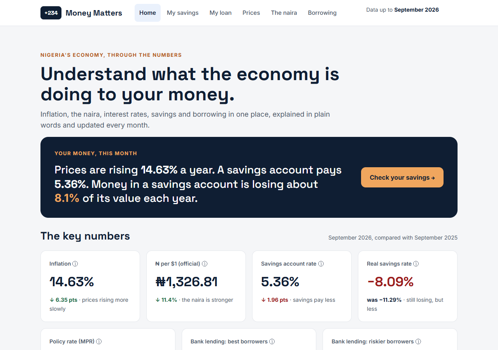
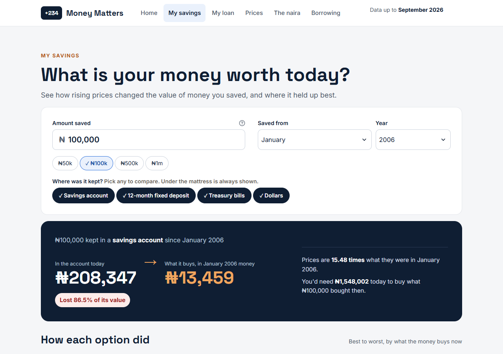
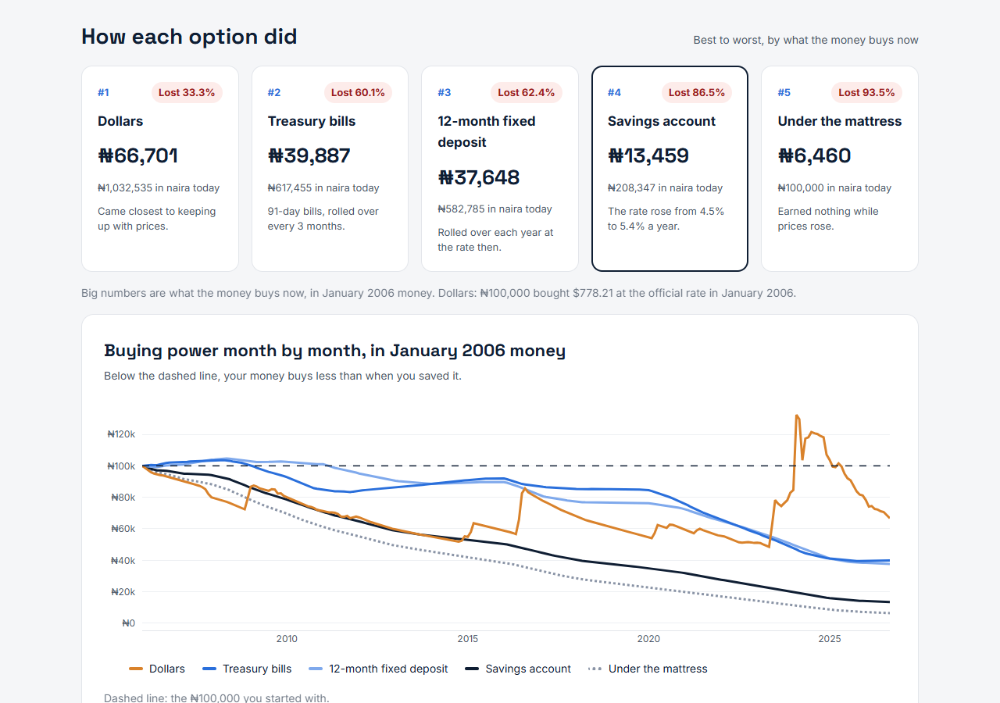
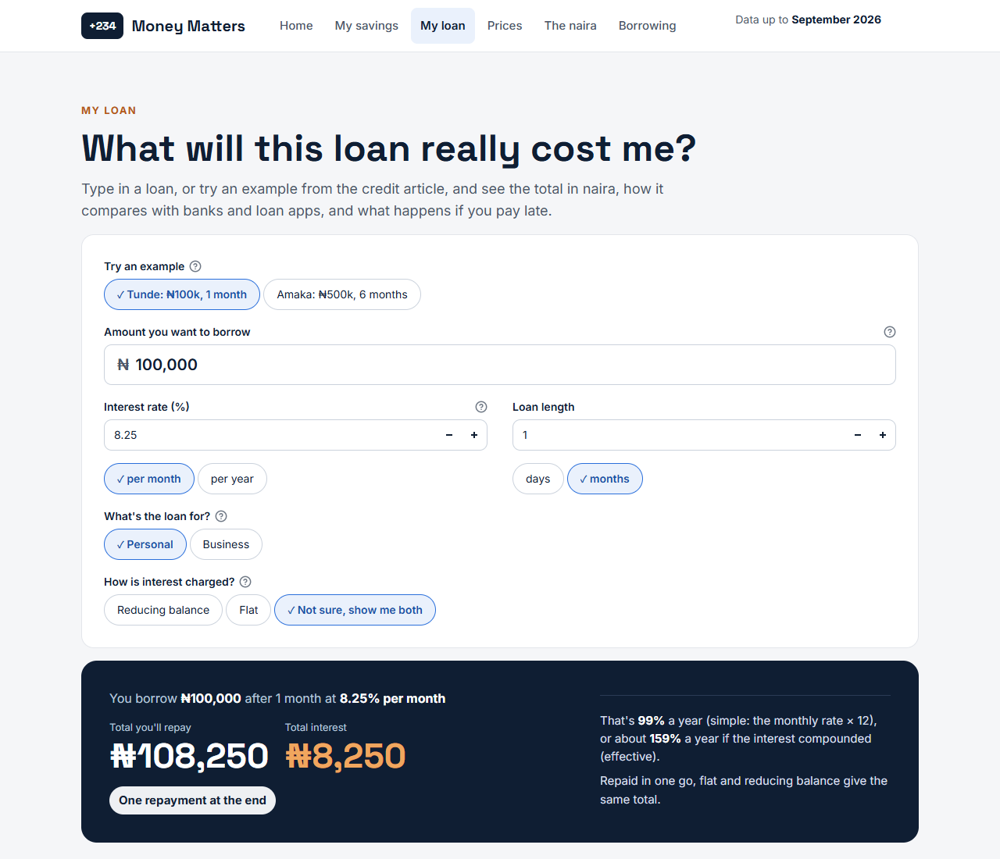
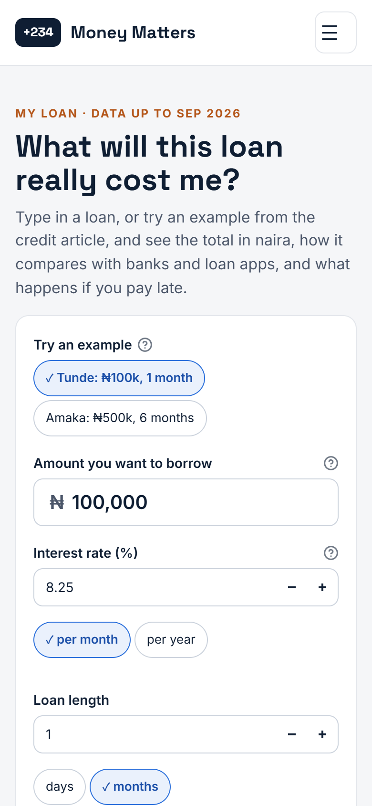
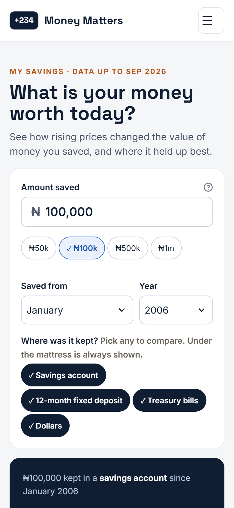
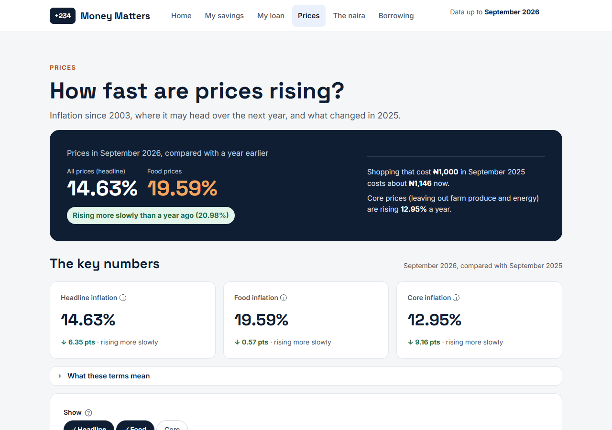
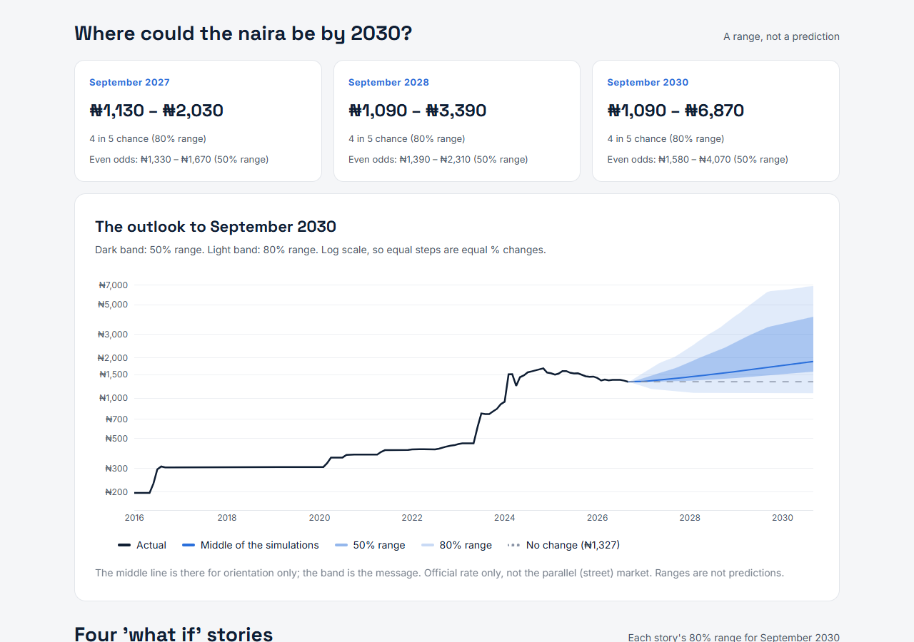
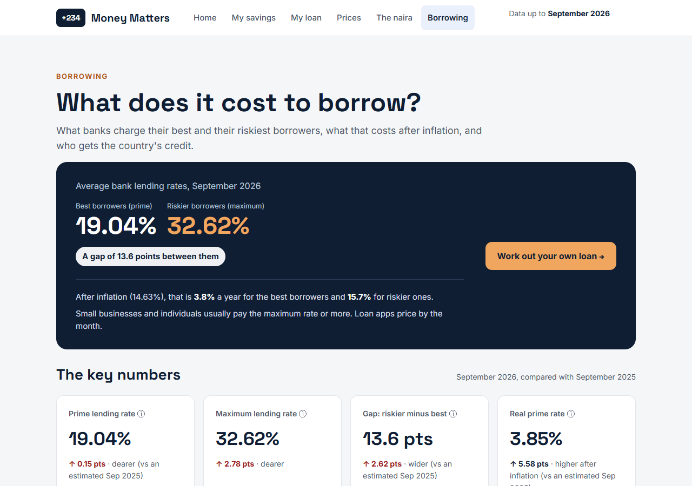
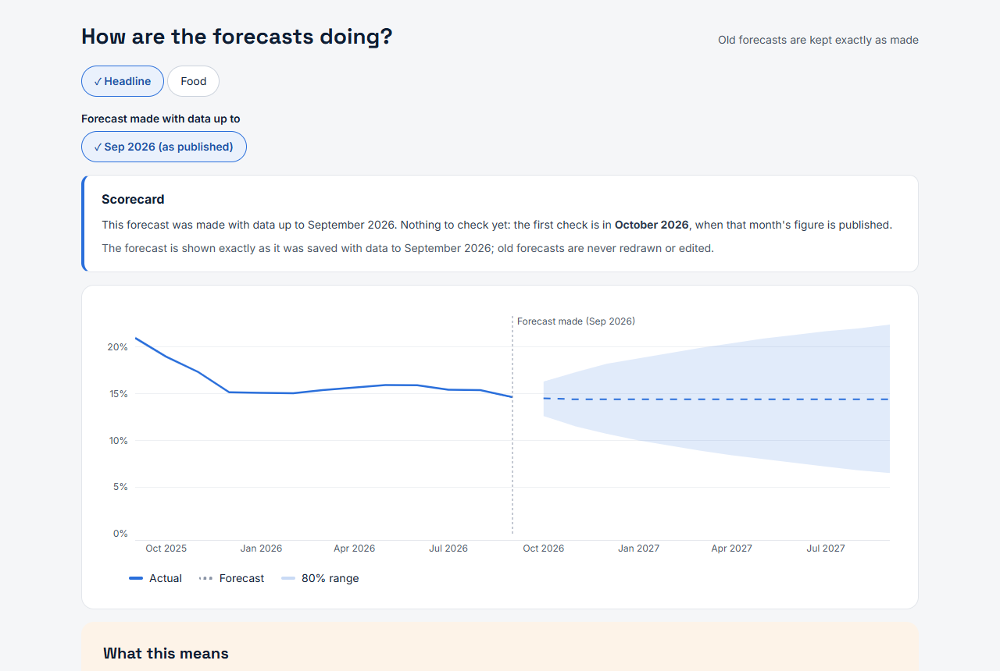

# (+234) Money Matters

**Understand what the economy is doing to your money.**
*Nigeria's economy, through the numbers.*

Money Matters is a data-driven platform that helps Nigerians understand how the economy affects their everyday
finances. It brings together key economic indicators such as inflation, exchange rates, interest rates, savings and
borrowing into one interactive dashboard. Users can explore historical trends, understand how the value of their
money has changed over time, compare financial scenarios, and see what the numbers mean for their personal and
business decisions. The platform brings together data from multiple research projects into one place, with regular
monthly updates.

> ⚠️ **Not financial advice.** This is a learning project built on official data. It does not recommend any bank,
> loan app, investment or lender. Past figures don't predict future ones, and every forecast here is a range.

## 📱 Open the app: [money-matters-ng.streamlit.app](https://money-matters-ng.streamlit.app/)

It works on your phone. It asks for no personal details and stores nothing you type.



---

## Why this exists

Over four projects I kept asking one question from different angles: **what does the economy do to an ordinary
Nigerian's money?**

- [How fast are prices rising, and where are they heading?](https://github.com/Freedom15dev/nigeria-inflation-forecast)
- [Did your savings beat inflation?](https://github.com/Freedom15dev/nigeria-savings-vs-inflation)
- [How much worse can the naira get?](https://github.com/Freedom15dev/naira-scenarios)
- [Who gets to borrow in Nigeria, and at what price?](https://github.com/Freedom15dev/nigeria-credit-squeeze)

Each one lives in a notebook and an article. People read an article once, and the numbers in it start going out of
date the day it's published. So Money Matters puts all four in one place that people can **use** with their own
numbers, and that **stays current**: every week it checks the Central Bank of Nigeria (CBN) for new figures and
updates itself.

I wanted a shop owner to understand every number on it, and an analyst to respect the code behind it.

---

## The short answer

Using CBN data up to **September 2026**:

| The question | What the numbers say |
|---|---|
| How fast are prices rising? | **14.63% a year.** Food prices are rising faster, at **19.59%**. |
| What does a savings account pay? | **5.36% a year**, so money in a savings account is losing about **8.1%** of its value each year. |
| What happened to money saved in 2006? | ₦100,000 put in a savings account in January 2006 is now **₦208,347**, but prices rose 15.5×, so it buys what **₦13,459** bought then. |
| What happened to the naira? | **₦128.50** to the dollar in January 2006, **₦1,326.81** in September 2026. Just **16 jump months** (falls of more than 5% in a month) account for about **99%** of that fall. |
| Where could the naira be by 2030? | A 4-in-5 chance of between **₦1,090 and ₦6,870** per dollar by September 2030. A range, not a prediction. |
| Where is inflation heading? | The middle of the forecast stays at about **14.4%**, but the honest answer is the range: **6.5% to 22.4%** by September 2027. |
| What does it cost to borrow? | Banks charge their best customers **19.04%** and riskier ones **32.62%**, a gap of **13.6 points** (1.5 in 2006). |
| And with a loan app? | Tunde's ₦100,000 for one month at 8.25% costs **₦108,250**; at the banks' maximum rate it would be **₦102,718**. If he pays 90 days late at 1% a day, it becomes **₦205,675**. |

**In plain words:**
- **Saving in naira loses.** Every common way of saving lost buying power since 2006. Cash under the mattress kept only
  6.5% of it; a savings account 13.5%. Dollars lost the least, in sudden bursts.
- **The naira doesn't slide, it jumps.** Almost all of 20 years of decline came in a handful of months, and nobody can
  say when the next one comes. So the outlook is a wide range, and the app says so.
- **Borrowing is priced by who you are.** Big companies pay near the prime rate; small businesses and individuals pay
  the maximum or more, and loan apps price by the month. The real danger is the highest advertised rates and what
  happens after the due date.

---

## What you can do with it

### 1. My savings: what is my money worth today?

Type in any amount and the month you saved it (from January 2006), and pick where it was kept: a savings account, a
12-month fixed deposit, Treasury bills or dollars. Cash under the mattress is always shown as the baseline. You get
what it's worth in naira today, what it can actually **buy** compared with when you saved it, and the options ranked
from best to worst.





### 2. My loan: what will this loan really cost me?

The [loan calculator](https://github.com/Freedom15dev/nigeria-credit-squeeze) from my credit project now lives here.
Type in a loan, or try Tunde's or Amaka's from the article, and see the total in naira, the yearly rate (simple and
effective), flat vs reducing balance, a month-by-month breakdown, how it compares with bank rates (updated monthly)
and advertised loan app rates, and what happens if you pay late. No lender is named.



<p>
  
  
</p>

### 3. Prices: how fast are prices rising?

Headline, food and core inflation since 2003, with the January 2025 rebasing marked and a plain note on the January
2026 revision. Then the next 12 months, shown as a range, with an honest explanation of why the middle line is flat.



### 4. The naira: how much is the naira worth?

The official dollar rate since 2003 with every jump month marked, a normal or log scale, the backtest-adjusted outlook
to 2030, and four "what if" stories: stable reforms, history repeats, an oil shock and a policy reversal.



### 5. Borrowing: what does it cost to borrow?

Prime vs maximum lending rates with the gap shaded, lending rates after inflation, and how much of the country's credit
goes to government instead of businesses and households.



### 6. How are the forecasts doing?

This is the part I care most about. Every month, the forecasts are **frozen** exactly as they were made, and checked
against what actually happened as each new month arrives: the miss, whether it landed inside the range, and how a
simple "no change" guess would have done. Misses are shown as clearly as hits, old forecasts are never redrawn, and the
page says when a few months is too early to judge. The first checks come with the October 2026 figures.



---

## How it stays current

1. **Every Monday** a GitHub Action pulls the latest CBN feeds (and US prices from FRED).
2. It cleans them, rebuilds the monthly table, re-runs both forecast models and freezes the new forecasts.
3. It runs every check before anything is saved:
   - one row per month, no gaps except known ones, no going backwards, values in sensible ranges;
   - every figure up to September 2026 must match the four earlier projects (known differences are listed in the log);
   - the savings article, the credit article and **all 43 published forecast numbers** must still be reproduced;
   - no saved forecast may have changed since it was saved.
4. Only if the **data** changed does it commit the new figures, and the app redeploys itself.

If any check fails, the run turns red and the app keeps the old data. The app itself never calls the CBN, so it keeps
working even when the CBN site is down.

---

## What I learned building it

- **Reproduce first, then build.** Before porting a single model, I made each one reproduce its published article
  exactly. The naira outlook matches to the nearest ₦10 and the inflation forecast to 0.1 point, and every weekly run
  checks it again.
- **Official data has traps, and each one needs a note.** June 2025 inflation repeats May; the MPR shows 0% before it
  existed; two Treasury bill months show 0%; the prime rate shows 11.90% for one month between two months of 18.9%;
  three days of exchange rates are typing errors (₦1,376.80 instead of ₦136.80). Each is fixed by a rule, logged, and
  explained on the page under "Under the hood".
- **Freezing forecasts keeps you honest.** It's easy to show a forecast. It's harder to keep the old ones and show
  how wrong they were. Money Matters does both.
- **Small technical details can break trust.** A forecast's sixth decimal place came out differently on Windows and on
  GitHub's servers, which would have made a fake "data update" every month. Now the app only updates when the data does.

---

## Accessibility

- Checked with **axe-core** on every page at desktop and phone width: **0 violations**.
- Every link, button and input shows a clear focus ring when you move through the page with a keyboard.
- Checked at **360 px and 390 px** wide (common phone widths): no sideways scrolling, no text under 12 px, and every
  button and choice is big enough to tap.
- Colours never carry meaning alone: gains and losses are also written in words ("Lost 86.5% of its value").
- Every term has a plain-words explanation, in a "What these terms mean" section that works on phones too.
- **Limitation:** screen readers can't read the lines inside the charts. Every chart has a heading and a caption, and
  every page has a "What this means" summary built from the same numbers.

---

## Limitations (please read)

- **CBN averages, not your bank.** Every rate is an average across banks. Your own bank, account or loan will differ.
  Taxes and fees are not included.
- **The official exchange rate only.** Before the June 2023 unification, many people could only buy dollars on the
  parallel market at a weaker rate. Dollar results may be understated.
- **An approximate price index.** The CBN publishes inflation rates, not an index, so the index is built from the
  yearly rates. Start-to-end results are solid; values in between are rough.
- **Revised 2025 inflation.** The CBN feed holds the NBS's January 2026 revision, about 3 points above the figures first
  reported in the news. Money Matters uses the feed as it is, and says so.
- **Forecasts are ranges.** No model I tested could reliably say which way inflation will move a year ahead, and no
  model saw the June 2023 float coming. The ranges may still be too narrow in a crisis.
- **Loan app rates are a snapshot.** They were collected by hand from lender sites and news reports between April and
  November 2026, and they don't update. Bank rates do.
- **Patterns, not causes.** Charts show what happened together, not proof of what caused what.

---

## Methods at a glance

| Part | Method | From |
|---|---|---|
| Price index | Each yearly inflation rate turned into a monthly step and chained; base = the latest month | [Savings project](https://github.com/Freedom15dev/nigeria-savings-vs-inflation) |
| Savings growth | Savings account monthly (rate ÷ 12); fixed deposit locked 12 months; Treasury bills locked 3 months (91-day); dollars at the official rate | Savings project |
| Real rates | Fisher: (1 + rate) ÷ (1 + inflation) − 1 | All four |
| Inflation forecast | ARIMA(1,1,0) with a rebasing marker, 80% range; naive "no change" baseline; naira-trend scenario | [Inflation project](https://github.com/Freedom15dev/nigeria-inflation-forecast) |
| Naira outlook | Jump model (5,000 simulated paths, seed 42), top of the range raised by past misses, floor from the float era; four scenarios | [Naira project](https://github.com/Freedom15dev/naira-scenarios) |
| Loans | Flat and reducing-balance repayment, simple and effective yearly rates, late-payment charges | [Credit project](https://github.com/Freedom15dev/nigeria-credit-squeeze) |
| Forecast tracking | Frozen monthly vintages; actual minus forecast, inside the 50%/80% range, vs a "no change" guess | New |

---

## Data sources

The CBN data comes from **undocumented JSON feeds** behind the CBN website. They are not an official API and could
change or disappear, so each pull is saved and every run checks the data before using it.

| Source | What it gives |
|---|---|
| `https://www.cbn.gov.ng/api/GetAllInflationRates` | Headline, food and core inflation, monthly from January 2003 |
| `https://www.cbn.gov.ng/api/GetAllMoneyMarketIndicators` | Policy, deposit, Treasury bill and lending rates, monthly from January 2006 |
| `https://www.cbn.gov.ng/api/GetAllExchangeRates` | Daily official exchange rates (averaged to monthly) |
| `https://www.cbn.gov.ng/api/GetAllMoneyAndCreditStats` | Credit to government and to the private sector |
| `https://www.cbn.gov.ng/api/GetAllDailyCrude` | Crude oil price |
| [FRED: CPIAUCSL](https://fred.stlouisfed.org/series/CPIAUCSL) (US Bureau of Labor Statistics) | US consumer prices, for the inflation gap in the naira scenarios |
| [Credit project: loan_offers.csv](https://github.com/Freedom15dev/nigeria-credit-squeeze/blob/main/data/loan_offers.csv) | Advertised loan app rates, checked April–November 2026 |

---

## How to run it (Windows)

1. Install [Python](https://www.python.org/downloads/) (3.15 was used) and [Git](https://git-scm.com/).
2. In a terminal:
   ```bash
   git clone https://github.com/Freedom15dev/nigeria-money-dashboard.git
   cd nigeria-money-dashboard
   python -m venv .venv
   .venv\Scripts\activate
   pip install -r requirements.txt
   ```
3. Run the checks, then open the app:
   ```bash
   python src/money_math.py          # savings maths: reproduces the savings article
   python src/loan_math.py           # loan maths: hand-worked examples
   python src/loan_offers.py         # loan app tiers and bank rates match the credit article
   python pipeline/run_all.py        # pull the latest data, check everything, update data/processed/
   python tests/smoke_test_app.py    # every page renders with the right numbers
   streamlit run app/Home.py         # opens at http://localhost:8501
   ```
   `python pipeline/run_all.py --offline` rebuilds from the saved data without downloading. If the data hasn't
   changed, nothing is written; add `--rebuild` to write everything anyway (for example after changing the code).

---

## Repository structure

```
nigeria-money-dashboard/
├── app/
│   ├── Home.py                  # entry point: page set-up and navigation
│   ├── components.py            # shared design: header, cards, charts, footer, forecast tracker
│   └── views/                   # home, savings, loan, prices, naira, borrowing
├── pipeline/
│   ├── fetch.py                 # download the CBN feeds and FRED
│   ├── clean.py                 # one function per known data trap
│   ├── build.py                 # the monthly table and the price index
│   ├── models.py                # inflation forecast and naira outlook, with the article check
│   ├── validate.py              # every check before anything is saved
│   ├── vintages.py              # frozen forecasts and their fingerprints
│   ├── track.py                 # scores old forecasts against what happened
│   ├── published_vintages.py    # the forecasts exactly as published in the articles
│   ├── rerun_vintages.py        # the published naira model re-run, month by month
│   └── run_all.py               # fetch → clean → build → models → validate → save
├── src/
│   ├── money_math.py            # savings and price maths, with self-checks
│   ├── loan_math.py             # loan maths, with hand-worked self-checks
│   └── loan_offers.py           # bank rates and loan app tiers
├── data/
│   ├── raw/                     # the latest pulls and a manifest of when they were taken
│   ├── processed/               # what the app reads
│   ├── forecasts/               # frozen forecast vintages (never edited)
│   └── reference/               # the four earlier projects' data, used as the check
├── tests/smoke_test_app.py      # renders every page and checks the numbers on screen
├── docs/screenshots/            # the images in this README
├── design/                      # the page mockups
├── .github/workflows/monthly.yml  # data update (runs weekly)
└── LICENSE                      # MIT, for the code
```

---

## Licence

The **code** is released under the [MIT License](LICENSE): you may reuse, change and share it, as long as the
copyright notice stays with it.

The **data is not mine to license.** The economic figures belong to the **Central Bank of Nigeria** (CBN) and, for US
consumer prices, the **US Bureau of Labor Statistics** (via FRED). The loan app rates are as advertised by each lender
and reported in the press. If you reuse the data, credit those sources and check their terms.

---

## Keywords

Nigeria inflation, naira exchange rate, CBN data, savings vs inflation, loan calculator, loan apps Nigeria, interest
rates, Python, Streamlit, data analysis, forecasting, Monte Carlo, ARIMA.

---

## About

Built by [Freedom Oboh](https://oboh.com.ng/), a data analyst and Excel trainer in Lagos, with Python and Streamlit.
Once a credit risk analyst; now asking what the economy does to ordinary Nigerians' money, one dataset at a time.

- Articles: [Inflation](https://www.linkedin.com/pulse/i-analysed-23-years-nigerian-inflation-data-heres-what-freedom-oboh-vumkf) ·
  [Savings](https://www.linkedin.com/pulse/i-followed-100000-20-years-heres-what-happened-nigerian-freedom-oboh-o090f) ·
  [The naira](https://www.linkedin.com/pulse/how-much-worse-can-naira-get-i-tried-find-out-freedom-oboh-ibxaf) ·
  [Borrowing](https://www.linkedin.com/pulse/who-gets-borrow-nigeria-i-followed-two-borrowers-find-freedom-oboh-q6mof)
- [LinkedIn](https://www.linkedin.com/in/freedomoboh) · [GitHub](https://github.com/Freedom15dev)

*Educational, not financial advice. Data: Central Bank of Nigeria (and US BLS via FRED for the naira page).*
